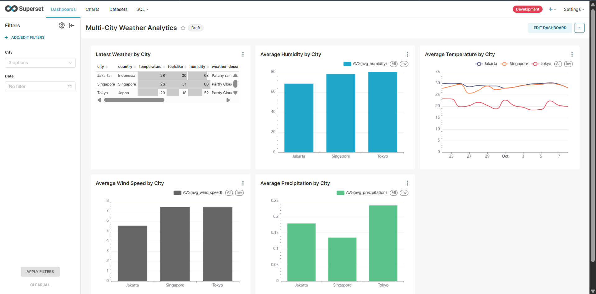
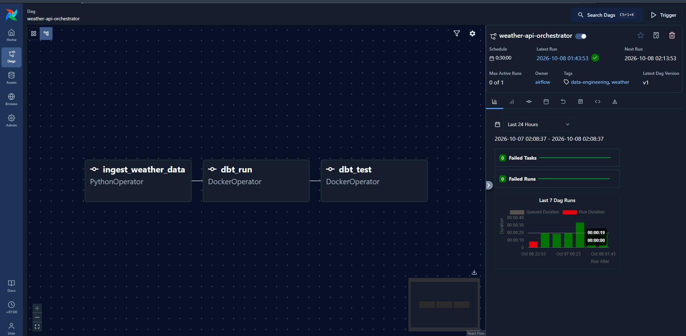

# Real-Time Multi-City Weather Data Pipeline
This project is an end-to-end weather data pipeline that collects weather data for Jakarta, Singapore, and Tokyo.

The live data is pulled from Weatherstack every 30 minutes using Airflow. I also added historical weather data from Open-Meteo so the dashboard has enough data to show trends instead of only current values.

The data is stored in PostgreSQL, transformed using dbt, and visualized in Apache Superset.

## Tech Stack
- Python
- Apache Airflow
- PostgreSQL
- dbt
- Apache Superset
- Docker
- Weatherstack API
- Open-Meteo API

## How It Works
The main pipeline looks like:

Weatherstack API
      ↓
Apache Airflow
      ↓
PostgreSQL
      ↓
dbt
      ↓
Apache Superset

Airflow runs the ingestion every 30 minutes and stores the raw weather data in PostgreSQL.

dbt is then used to clean and transform the data into tables that are easier to use for analysis. I also added dbt tests to check for things like null values and duplicate records.

For historical data, I created a separate backfill script using Open-Meteo.

## Data Collected
The pipeline currently collects:

- Temperature
- Feels like temperature
- Humidity
- Weather condition
- Wind speed
- Pressure
- Precipitation

for:

- Jakarta
- Singapore
- Tokyo

## dbt Models
The main models are:

- `stg_weather_data` - cleans and deduplicates the raw weather data
- `daily_average` - calculates daily weather averages for each city
- `weather_report` - returns the latest weather record for each city

## Dashboard
The Superset dashboard includes:

- Latest weather by city
- Average temperature by city
- Average humidity by city
- Average wind speed by city
- Average precipitation by city
- City and date filters

## Dashboard Preview

## Airflow DAG
The pipeline is orchestrated with Airflow and runs every 30 minutes.

## Historical Backfill
Since the live Weatherstack API only gives current weather data, I added a separate script using Open-Meteo to load historical weather data.

This allows the dashboard to show weather trends across multiple days without having to keep the pipeline running for weeks first.
